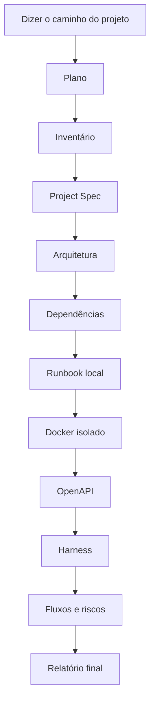

# Shadow Project AI

Jeito de entender um repositório sem alterar o código. Cada pessoa instala a skill na própria máquina, abre o projeto que quer analisar e pede uma fase. O código alvo só é lido. Os markdowns saem numa pasta à parte, o dossiê, fora do Git desse projeto.

A skill se chama **Shadow Project AI** e está em [reluviari/my-skills](https://github.com/reluviari/my-skills), pasta `shadow-project-ai`. O mesmo passo a passo de instalação está no `SKILL.md`.

## 1. Instalar, uma vez por pessoa

Na pasta onde você guarda repositórios:

```sh
git clone https://github.com/reluviari/my-skills.git
cd my-skills
KIT="$(pwd)"
name="shadow-project-ai"
for h in "$HOME/.claude/skills" "$HOME/.cursor/skills" "$HOME/.agents/skills" "$HOME/.codex/skills"; do
  mkdir -p "$h"
  ln -sfn "$KIT/$name" "$h/$name"
done
```

Feche e abra de novo o Claude, o Cursor ou o Codex. `Shadow Project AI` passa a chamar esta skill em qualquer chat.

Quem já tiver o clone só repete o bloco a partir de `cd my-skills`. Não copie a pasta da skill para outro lugar: o symlink aponta para o clone, e um `git pull` atualiza todo mundo que ligou assim.

## 2. Rodar num projeto novo

Não existe arquivo de configuração. Você não troca `<REPO_ALVO>` na mão. O caminho do projeto vai na frase.

1. Abra o chat na pasta do projeto que vai ser analisado.
2. Envie o caminho completo, com a pasta de verdade no lugar de `~/projetos/api-pedidos`:

```text
Shadow Project AI, inicia o dossiê de ~/projetos/api-pedidos
```

3. A fase 00 responde com três nomes e para. Confira se o código e o dossiê estão certos.
4. Diga `próxima fase`. Leia o arquivo gerado. Repita até a fase 10.
5. No fim, o agente compara o estado do projeto e lista só o que criou no dossiê.

Para uma fase só: `Shadow Project AI, fase 03`. Para todas numa conversa: `Shadow Project AI, sessão completa`. Build, rede, teste e container continuam pedindo autorização.

### Os três nomes

Você informa o projeto. O agente calcula o resto e mostra na fase 00.

| Nome | O que é | Se você disse `~/projetos/api-pedidos` |
|---|---|---|
| `REPO_ALVO` | Nome da pasta | `api-pedidos` |
| `REPO_PATH` | Onde está o código. Nada é escrito aqui | `~/projetos/api-pedidos` |
| `DOSSIER_PATH` | Onde saem os markdowns, fora do Git do projeto | `~/projetos/_analises-privadas/api-pedidos` |

O dossiê nasce ao lado do projeto, em `_analises-privadas/<nome-da-pasta>`. Se essa pasta cair dentro de outro Git, o agente propõe outro lugar e espera confirmação. Para escolher o destino:

```text
Shadow Project AI, inicia o dossiê de ~/projetos/api-pedidos. O dossiê fica em ~/analises/api-pedidos
```

Outra pessoa, em outra máquina, repete os mesmos dois passos com o caminho dela. O dossiê fica na máquina de quem rodou. Ele não entra no repositório analisado.

## O que dizer

| Você diz | O que acontece |
|---|---|
| `Shadow Project AI, inicia o dossiê de <caminho>` | Fase 00. Valida o caminho, grava o plano e para |
| `próxima fase` | A primeira fase cujo arquivo ainda não existe |
| `Shadow Project AI, fase 03` | Só a arquitetura, se o arquivo da fase anterior existir |
| `Shadow Project AI, sessão completa` | Fases 00 a 10, em ordem |

| Fase | Arquivo no dossiê |
|---|---|
| 00 | `00-plano-de-analise.md` |
| 01 | `00-contexto-e-inventario.md` |
| 02 | `01-project-spec.md` |
| 03 | `02-arquitetura.md` |
| 04 | `03-dependencias-e-integracoes.md` |
| 05 | `04-runbook-local.md` |
| 06 | `05-plano-docker.md` |
| 07 | `06-openapi.yaml` e `06-relatorio-openapi.md` |
| 08 | `07-harness.md` |
| 09 | `08-fluxos-criticos.md` e `09-riscos-e-lacunas.md` |
| 10 | `10-relatorio-final.md` |

A fase 06 pode acrescentar `laboratorio-docker/`. A fase 08 pode acrescentar `harness/`.

## Sequência



## Modos

- **Inspeção estática.** Padrão. Só lê arquivos.
- **Validação controlada.** Testes e builds que o próprio repositório já documenta, depois que você autorizar.
- **Laboratório privado.** Dockerfile, Compose e scripts só dentro do dossiê.

## Regras

- Nada é criado, editado ou apagado dentro do projeto alvo.
- Sem commit, push, PR ou limpeza desse repositório.
- Secret aparece só pelo nome, a origem e a finalidade. O valor fica mascarado.
- Sem migração, seed, fila, job ou chamada a ambiente compartilhado.
- Cada afirmação é **Confirmado**, **Inferido** ou **Não confirmado**, com o arquivo que sustenta.
- Se um comando puder mudar algo fora do dossiê, o agente para e pede autorização.

Os arquivos `00` a `10` e o `99` deste repositório repetem o roteiro para um agente sem a skill. Com a skill instalada, não é preciso colar esses prompts.
