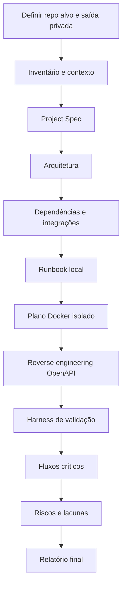

# Shadow Project AI

Este pacote ajuda a entender um repositório da empresa sem alterar o código original. O repositório alvo é fonte **somente de leitura**; todo material produzido forma um dossiê privado em outro diretório.

## Resultado esperado

```text
/repos/
├── <REPO_ALVO>/                         # somente leitura
└── _analises-privadas/
    └── <REPO_ALVO>/                     # todos os artefatos gerados
        ├── 00-contexto-e-inventario.md
        ├── 01-project-spec.md
        ├── 02-arquitetura.md
        ├── 03-dependencias-e-integracoes.md
        ├── 04-runbook-local.md
        ├── 05-plano-docker.md
        ├── 06-openapi.yaml
        ├── 06-relatorio-openapi.md
        ├── 07-harness.md
        ├── 08-fluxos-criticos.md
        ├── 09-riscos-e-lacunas.md
        └── 10-relatorio-final.md
```

## Como usar

1. Abra seu assistente de código no diretório `/repos`.
2. Substitua `<REPO_ALVO>` e, se necessário, os caminhos nos prompts.
3. Execute primeiro `00-prompt-mestre.md`; ele estabelece contexto, limites e diretório de saída.
4. Execute os prompts de `01` a `10`, na ordem. Revise cada resultado antes de seguir.
5. Se quiser uma única execução, use `99-prompt-completo.md` em vez da sequência temática.
6. No final, confira se nenhum arquivo do repositório alvo foi alterado. O assistente deve mostrar o estado antes/depois e listar somente os arquivos criados no dossiê.

## Sequência



## Modos de execução

- **Inspeção estática:** padrão seguro. Apenas lê arquivos e não inicia serviços.
- **Validação controlada:** executa comandos não destrutivos, testes e builds já existentes. Deve pedir confirmação antes de baixar dependências, acessar rede, iniciar containers ou serviços.
- **Laboratório privado:** pode criar Dockerfiles, Compose, scripts e specs, mas somente no diretório do dossiê. Nunca copia segredos.

## Regras essenciais

- Nunca editar, criar, apagar, mover, formatar ou gerar arquivos dentro de `/repos/<REPO_ALVO>`.
- Nunca fazer commit, push, PR, checkout destrutivo ou limpeza do repositório.
- Não revelar valores de secrets; registrar apenas nome, origem e finalidade, com valor mascarado.
- Não executar migrações, seeds, filas, jobs ou chamadas contra ambientes compartilhados.
- Não assumir que exemplos são produção. Marcar cada afirmação como **Confirmado**, **Inferido** ou **Não confirmado**.
- Citar evidências por caminho de arquivo e, quando possível, linha/símbolo.
- Se uma validação puder mudar estado externo, parar e pedir autorização.

Leia também `CONVENCOES.md` antes de adaptar os prompts.

## Índice dos prompts

| Arquivo | Objetivo |
|---|---|
| `00-prompt-mestre.md` | Criar contexto, limites e plano |
| `01-inventario-contexto.md` | Identificar stack, estrutura e responsabilidade |
| `02-project-spec.md` | Produzir a especificação funcional/técnica |
| `03-arquitetura.md` | Mapear componentes, fronteiras e fluxos |
| `04-dependencias-integracoes.md` | Catalogar infraestrutura e sistemas externos |
| `05-runbook-local.md` | Explicar como preparar, iniciar, verificar e diagnosticar |
| `06-docker-isolado.md` | Desenhar empacotamento e execução isolada |
| `07-openapi-reverse-engineering.md` | Inferir e validar o contrato HTTP |
| `08-harness-validacao.md` | Projetar testes contra a aplicação isolada |
| `09-fluxos-riscos.md` | Registrar fluxos críticos, riscos e lacunas |
| `10-relatorio-final.md` | Consolidar o dossiê e próximos passos |
| `99-prompt-completo.md` | Executar todo o processo em uma só sessão |

